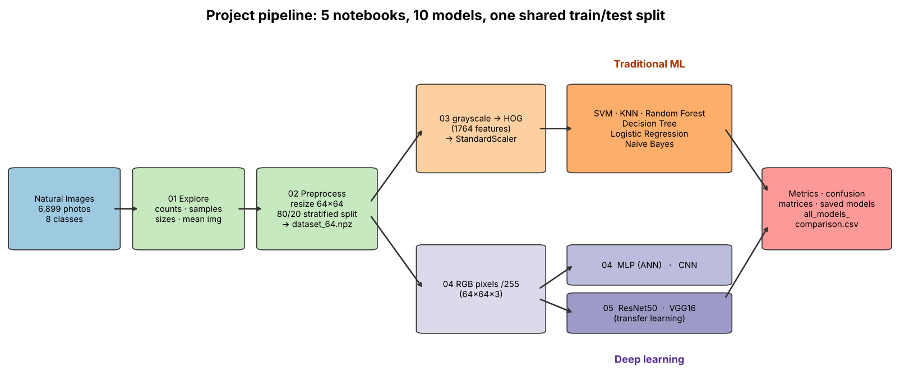

# Natural Images - Image Classification Project
10 models · 5 notebooks · one shared train/test split



## 1. Models
| Family | Models |
|---|---|
| Traditional ML on **HOG** features | 1 SVM · 2 KNN · 3 Random Forest · 4 Decision Tree · 5 Logistic Regression · 6 Naive Bayes |
| Deep learning on images | 7 MLP/ANN · 8 CNN · 9 ResNet50 (transfer learning) · 10 VGG16 (transfer learning) |

## 2. Folder structure
```
image_classification_project/
├── notebooks/
│   ├── 01_data_exploration.ipynb
│   ├── 02_preprocessing.ipynb
│   ├── 03_hog_traditional_ml.ipynb
│   ├── 04_deep_learning.ipynb
│   └── 05_transfer_learning_evaluation.ipynb
├── src/common.py              <- paths, settings, loader, evaluation (shared by all notebooks)
├── data/raw/natural-images/   <- PUT THE 8 CLASS FOLDERS HERE
├── data/processed/            <- created by notebooks 02 / 03
├── models/                    <- saved trained models
├── results/figures/           <- every figure produced by the notebooks
├── results/metrics/           <- one json + classification report per model
├── results/all_models_comparison.csv   <- created by notebook 05
├── docs/model_steps/          <- step-by-step "how it works" image of each of the 10 models
└── tools/                     <- scripts that generated the notebooks and docs images
```

## 3. How to run
1. Extract the ZIP (e.g. on your Desktop) and open the folder in VS Code.
2. Download the **Natural Images** dataset (Kaggle, by Prasun Roy) and place the eight class folders here:
   ```
   data/raw/natural-images/
       airplane/  car/  cat/  dog/  flower/  fruit/  motorbike/  person/
   ```
3. Install the libraries (VS Code terminal):
   ```
   pip install -r requirements.txt
   ```
   (TensorFlow needs a 64-bit Python 3.9 - 3.12.)
4. Launch Jupyter: `jupyter notebook`, then open the `notebooks/` folder.
5. Run the notebooks **in order**: 01 → 02 → 03 → 04 → 05 (each one uses the files created by the previous one).

### Quick test run (recommended first)
Uses 40 images per class and 2-3 epochs, no pretrained download - finishes in a few minutes and proves your installation works.
* Windows PowerShell: `$env:NI_QUICK=1; jupyter notebook`
* Windows cmd: `set NI_QUICK=1 && jupyter notebook`
* macOS / Linux: `NI_QUICK=1 jupyter notebook`

Then restart *without* the variable for the real run (delete `data/processed/*.npz` and `results/metrics/*.json` first so quick-test numbers don't remain).

### If the computer is slow
Edit `src/common.py`: lower `EPOCHS`, or set `MAX_PER_CLASS = 300`. ResNet50 and VGG16 are the heaviest and download ImageNet weights on first use (internet needed).

## 4. Step-by-step process of each model
Each image shows: load → resize/gray → feature extraction → split/scale → training → evaluation.
(Photos and HOG maps are real computations; the training panels of models 1-6 use small 2-D toy data to *illustrate* the idea.)

| # | Model | Image |
|---|---|---|
| - | HOG in detail | `docs/00_hog_step_by_step.png` |
| 1 | SVM | `docs/model_steps/01_svm.png` |
| 2 | KNN | `docs/model_steps/02_knn.png` |
| 3 | Random Forest | `docs/model_steps/03_random_forest.png` |
| 4 | Decision Tree | `docs/model_steps/04_decision_tree.png` |
| 5 | Logistic Regression | `docs/model_steps/05_logistic_regression.png` |
| 6 | Naive Bayes | `docs/model_steps/06_naive_bayes.png` |
| 7 | MLP / ANN | `docs/model_steps/07_mlp_ann.png` |
| 8 | CNN | `docs/model_steps/08_cnn.png` |
| 9 | ResNet50 | `docs/model_steps/09_resnet50.png` |
| 10 | VGG16 | `docs/model_steps/10_vgg16.png` |

The same images are embedded inside the notebooks at the start of each model section. When you run the notebooks, they also create *your real* result figures (confusion matrices, learning curves, feature maps, importance maps...) in `results/figures/`.

## 5. What you obtain
* Accuracy, precision, recall, F1 for each model (`results/metrics/*.json`)
* Confusion matrices + classification reports (`results/figures/cm_*.png`, `results/metrics/*_report.txt`)
* Saved models (`models/`)
* `results/all_models_comparison.csv` and `results/figures/all_models_comparison.png`

## 6. Key design choices (useful for your report)
* **Same split for all models**: stratified 80/20, `random_state=42`, saved once in notebook 02.
* **HOG**: grayscale 64×64, 9 orientations, 8×8 cells, 2×2 blocks, L2-Hys → 1,764 features.
* **StandardScaler is fitted on the training set only** (no information leak from test data).
* Hyper-parameters that are *tuned* (k for KNN, depth for the tree) are selected by cross-validation on the **training** set - the test set is only used for the final scores.
* Transfer learning in two phases: frozen base (feature extraction) → partial fine-tuning with lr 1e-5.

## 7. Notes
* The notebooks were tested end-to-end in quick mode on a synthetic 8-class dataset; no accuracy numbers are shipped because they depend on running on the real dataset on your machine.
* To regenerate the docs images: `python tools/make_step_images.py`; to rebuild the notebooks: `python tools/build_notebooks.py`.
